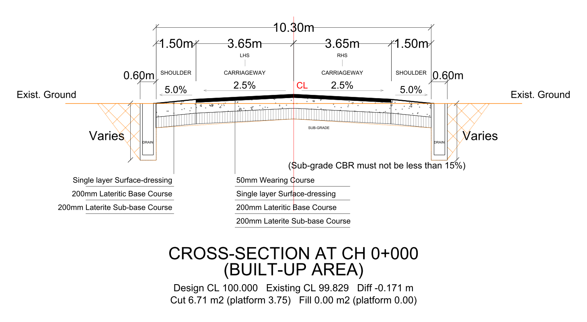

# Cross-Section Sandbox

Turn total-station survey points (or a stations/ground table) into road cross-section
drawings, as DXF and PNG, from a small Streamlit app.



## Run

```bash
python -m venv venv
source venv/bin/activate          # Windows: venv\Scripts\activate
pip install -r requirements.txt
streamlit run app.py
```

Then open http://localhost:8501 and upload a file in the sidebar.

## Input: total-station CSV (primary workflow)

A point file with `North, East, Height` and a side-code column (`C` / `L` / `R`):

```csv
POINT,North,East,Height,Code
P1,997861.2633,543063.4404,297.3123,C
P2,997868.0328,543061.8938,297.2671,L
P3,997855.5552,543064.9443,297.2683,R
```

The app:

- splits the file into roads at text markers / large coordinate jumps;
- pairs every side shot with its nearest centre-line shot (not by row order);
- computes chainage from cumulative centre-line distance;
- computes true offsets, left negative / right positive, from the L→R axis;
- keeps the surveyed levels exactly as shot.

Feature codes (buildings, culverts, poles, river…) are ignored for the section
geometry; only `C`, `L` and `R` shots are used.

## Drawing modes (sidebar)

| Mode | What it draws |
|---|---|
| **Survey + road design** (default) | Surveyed ground plus the proposed pavement box: pavement layers, formation line, cut/fill hatching clipped to the surveyed width, shot markers, cross-falls, offsets, levels and a shot schedule. Survey geometry is never altered. |
| Surveyed ground only | Exactly the shots in the file — profile, markers, offsets, levels, surveyed width. No pavement. |
| Full design sheet | Complete design drawing: dimensions, drains, layer call-outs, cut/fill areas. |

With no design levels in the file, the pavement is placed at the surveyed centre line
(design level = surveyed CL); this is stated on the sheet and in the sidebar.

## Input: Stations / Ground / Parameters

One workbook with sheets `Stations`, `Ground`, `Parameters`, or three CSVs named
`stations.csv`, `ground.csv`, `parameters.csv`.

- **Stations**: Station, Design, Existing, Zone = Built-up/Rural
- **Ground**: Station, Offset (−left/+right), Level
- **Parameters**: Name, Value (optional)

`demo_builtup.xlsx` (or `demo_builtup/*.csv`) reproduces the built-up typical sheet:
10.30 m formation, 3.65 m lanes, 1.50 m shoulders, 0.60 m drains, 50/200/200 mm
pavement, 2.5 % camber, 5 % shoulder fall, CBR 15 %. See
[`demo_builtup/README.md`](demo_builtup/README.md) for which values came from the
reference sheet and which were deliberately left to defaults.

## CLI

```bash
python xsection.py your.xlsx --out sections.dxf
python xsection.py stations.csv ground.csv parameters.csv --out sections.dxf
python xsection.py "survey points.csv" --out sections.dxf
```

## Notes

- CSV parsing is tolerant: `,` `;` tab or `|` delimiters, UTF-8/UTF-16/Windows
  encodings, decimal commas (`297,325`), unit suffixes (`297.325 m`, `2.5%`),
  `CH 0+000` style stations, and a title row above the headers.
- The sidebar reports how many stations and ground points were loaded and warns
  about unreadable rows, unknown parameter names, or one-sided sections.
- PNG previews are rendered at 1460 px (Streamlit's limit) and downloads at higher
  resolution. DXF text height is set in the sidebar.
- Streamlit caches imported modules: restart the server after editing `xsection.py`.

## Project layout

| File | Purpose |
|---|---|
| `app.py` | Streamlit UI |
| `xsection.py` | Parsing, geometry, DXF/PNG rendering, CLI |
| `requirements.txt` | `streamlit, ezdxf, pandas, openpyxl, xlrd, matplotlib, numpy` |
| `demo_builtup.xlsx`, `demo_builtup/` | Test data for the built-up typical sheet |
| `typical_sections.dxf` | Example output |
